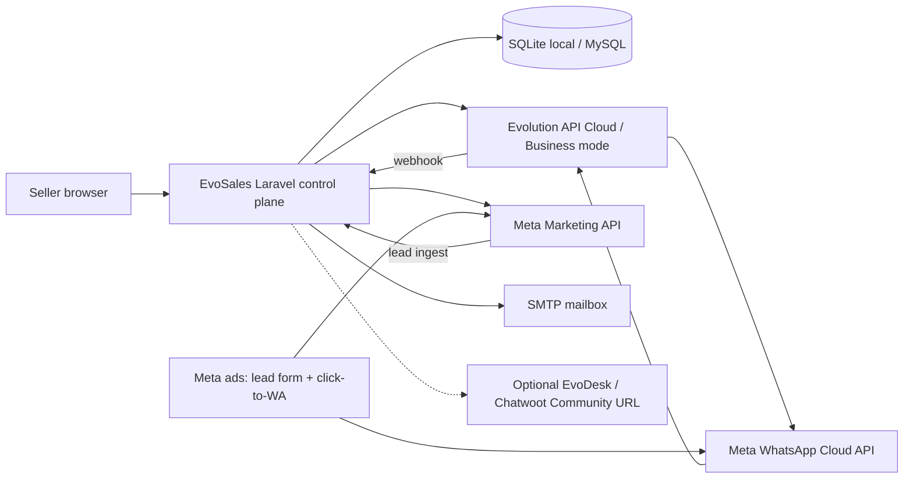
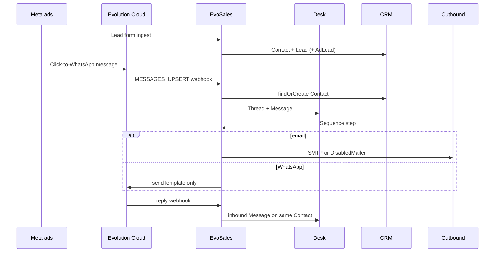

# EvoSales architecture

EvoSales is Evotechly’s single sales OS: **one workspace, one login, four rooms**.

It is the product control plane. Evolution API is the native WhatsApp Cloud connector. The **sold Desk** is [EvoDesk](https://github.com/Mohamedbeghanem/evodesk) (Chatwoot Community, MIT), **embedded inside the CRM at `/inbox`** — the iframe source is `EVOSALES_INBOX_URL` + optional `EVOSALES_INBOX_EMBED_PATH` (default `https://desk.evotechly.com` + `/`). Operators never leave the CRM hostname. If the desk deployment sends `X-Frame-Options: DENY`, allow-frame the CRM origin on the desk; clearing the workspace inbox URL makes `/inbox` serve the native CRM conversation desk instead (never an "Open Desk" eject to another host). This repo does not vendor Chatwoot, does not copy Chatwoot CSS/assets, and does not treat the Laravel inbox as the Chatwoot clone. EvoSales keeps only a lightweight conversation-history list as CRM context (contact ↔ deal).

Default timezone: **Africa/Algiers**. Algeria-first (`+213`). Company: **Evotechly**.

**EvoCRM** is the CRM surface of this OS (not a second repo). The approved build is [evocrm-plan.md](./evocrm-plan.md); Mobbin screens are frozen in [evocrm-mobbin-contract.md](./evocrm-mobbin-contract.md).

## What this is not

- Not Baileys, WhatsApp Web QR, Linked-devices, OpenWA, or any consumer-WhatsApp takeover.
- Not a Kommo / amoCRM UI clone.
- Not an Instantly clone.
- Not Chatwoot Enterprise.

## System context

## Bounded contexts

| Context | Responsibility |
| --- | --- |
| **Identity** | Workspace, User, RBAC (`owner` / `admin` / `member`) |
| **CRM** | Sales Hub: Company, Contact, Lead, Deal, Activity timeline, custom attributes, saved lists, quotes, local Product catalog + deal line items (DZD; Evostock later), reports. Operational density is the product — not a contact list. |
| **Desk** | Sold product: EvoDesk / Chatwoot Community, embedded at `/inbox`. In EvoSales: Channel, Thread, Message as conversation history synced for CRM context + optional composer |
| **Ads** | AdAccount, AdCampaign, AdSet, Ad, AdCampaignStat (daily insights), AdLead. Funnel: Impressions → Clicks → Conversations/Leads → Qualified → Deals → Won, attributed via `threads.ad_campaign_id` / `leads.ad_campaign_id` / `leads.ad_set_id` / `leads.ad_id`. Workspace Meta OAuth (encrypted `Integration`) drives Graph sync, Lead Ads webhooks, and Conversions API feedback. See [meta-integration.md](./meta-integration.md). |
| **Outbound** | Mailbox (SMTP + IMAP, warmup status, daily limit), OutboundTemplate (`{{variables}}`), Sequence, SequenceStep, Enrollment (active/paused/finished/cancelled), OutboundMessage (out + in, open pixel, replied_at), Suppression, QuietHours. `outbound:run` sends due steps every minute; `outbound:poll-replies` reads IMAP replies |
| **Evolution** | Cloud-only instance lifecycle, session text, template send, webhook ingest |
| **Integrations** | Workspace Meta OAuth (encrypted tokens), env app credentials, embedded EvoDesk URL; later Embedded Signup |

## Canonical objects

See [OBJECT_MODEL.md](./OBJECT_MODEL.md). Person identity is **one Contact**. A Desk `Thread` and a CRM `Deal` both point at that Contact.

## Event flow

Quiet hours (Africa/Algiers) and the suppression list run **before** automated Outbound sends. Human Desk replies use the Cloud session window (`sendText`) and are not blocked by quiet hours.

## Left-nav IA

- Home (open pipeline value + open tasks as next steps)
- My Inbox → `/inbox` (EvoDesk embedded in the CRM chrome; native CRM desk fallback)
- Conversations → history only (CRM context)
- CRM → Companies / Contacts / Leads / Deals (list hub + board + detail + associations sidebar) / Reports
- Campaigns → Ads Hub (`/ads` funnel board + campaign detail)
- Outbound → Overview / Mailboxes / Domains / Templates / Sequences / Campaigns / Outbox / Replies / Suppressions / Quiet hours / Reports — all under `/outbound` on the CRM hostname
- Settings → Evolution / Meta / Channels / Custom attributes (plus profile / security / appearance)

## Security

- Mailbox SMTP passwords use Laravel’s `encrypted` cast (APP_KEY).
- Meta app credentials (`META_APP_ID`, `META_APP_SECRET`) live in the environment. Workspace user/page tokens are encrypted on `integrations` (`APP_KEY`) and never sent to the frontend.
- Workspace RBAC: `owner` and `admin` manage settings; members work the rooms.
- Quiet hours default 21:00–08:00 `Africa/Algiers`.
- Public `/unsubscribe` writes Suppression.
- CSRF is disabled only for `/webhooks/*`.
- Unofficial WhatsApp paths throw `UnofficialWhatsAppRefused`.

## Later work (explicitly not this slice)

- Meta Tech Provider / Embedded Signup
- Evoleads scraper
- Bounce tracking via ESP webhooks (reports page is honest about this)
- Telegram channel (status `later`)

Live mail stack: `outbound.evotechly.com` (EvoOutreach) is used for SMTP send, IMAP reply polling, and Roundcube webmail only. Mailboxes sync from its HTTP API (`GET /api/mailbox/all`, Bearer token) via `outbound:sync-mailboxes` into `mailboxes` rows marked `source = mail_stack`; synced rows cannot be deleted in the CRM. The stack's BillionMail marketing dashboard is never linked or embedded — broadcast campaigns and drip sequences are native to EvoSales at `/outbound`; there is no second contact database and no mail server to run.
