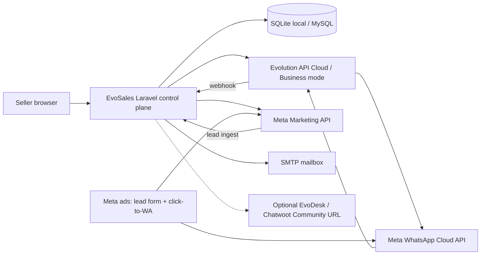
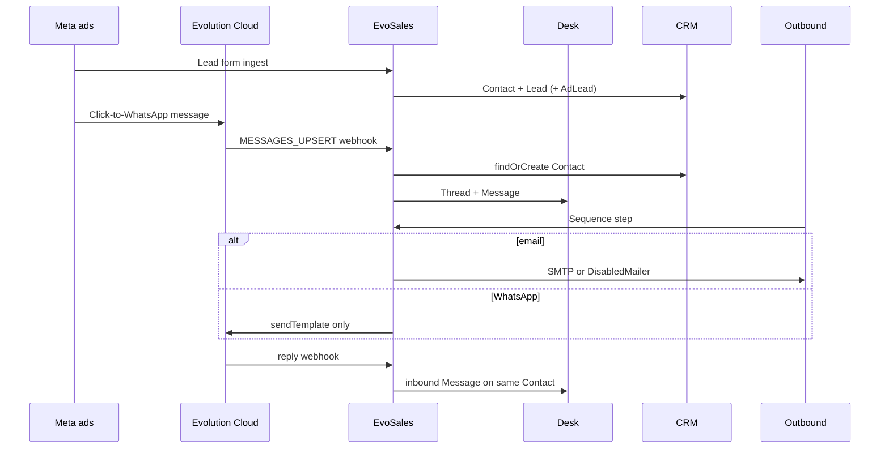

# EvoSales architecture

EvoSales is Evotechly’s single sales OS: **one workspace, one login, four rooms**.

It is the product control plane. Evolution API is the native WhatsApp Cloud connector. The **sold Desk** is [EvoDesk](https://github.com/Mohamedbeghanem/evodesk) (Chatwoot Community, MIT) at `EVOSALES_INBOX_URL` / `https://desk.evotechly.com`. This repo does not vendor Chatwoot, does not copy Chatwoot CSS/assets, and does not treat the Laravel inbox as the Chatwoot clone. EvoSales keeps only a lightweight conversation-history list as CRM context (contact ↔ deal).

Default timezone: **Africa/Algiers**. Algeria-first (`+213`). Company: **Evotechly**.

## What this is not

- Not Baileys, WhatsApp Web QR, Linked-devices, OpenWA, or any consumer-WhatsApp takeover.
- Not a Kommo / amoCRM UI clone.
- Not an Instantly clone.
- Not Chatwoot Enterprise.

## System context

## Bounded contexts

| Context | Responsibility |
| --- | --- |
| **Identity** | Workspace, User, RBAC (`owner` / `admin` / `member`) |
| **CRM** | Sales Hub: Company, Contact, Lead, Deal, Activity timeline, custom attributes, saved lists, quotes, reports. Operational density is the product — not a contact list. |
| **Desk** | Sold product: EvoDesk / Chatwoot Community. In EvoSales: Channel, Thread, Message as conversation history synced for CRM context + optional composer |
| **Ads** | AdAccount, AdCampaign, AdLead, Meta env settings |
| **Outbound** | Mailbox, Sequence, SequenceStep, Enrollment, OutboundMessage, Suppression, QuietHours |
| **Evolution** | Cloud-only instance lifecycle, session text, template send, webhook ingest |
| **Integrations** | Env-driven Meta + optional EvoDesk URL; later Embedded Signup / IMAP |

## Canonical objects

See [OBJECT_MODEL.md](./OBJECT_MODEL.md). Person identity is **one Contact**. A Desk `Thread` and a CRM `Deal` both point at that Contact.

## Event flow

Quiet hours (Africa/Algiers) and the suppression list run **before** automated Outbound sends. Human Desk replies use the Cloud session window (`sendText`) and are not blocked by quiet hours.

## Left-nav IA

- Home (open pipeline value + open tasks as next steps)
- Desk → `EVOSALES_INBOX_URL` (same window; default `https://desk.evotechly.com`)
- CRM → Companies / Contacts / Leads / Deals (list + detail + associations sidebar) / Unassigned / Reports / Conversations (history only)
- Ads
- Outbound → Mailboxes / Sequences / Templates / Suppression / Quiet hours
- Settings → Evolution / Meta / Channels / Custom attributes (plus profile / security / appearance)

## Security

- Mailbox SMTP passwords use Laravel’s `encrypted` cast (APP_KEY).
- Meta and Evolution tokens live in environment variables only — never committed.
- Workspace RBAC: `owner` and `admin` manage settings; members work the rooms.
- Quiet hours default 21:00–08:00 `Africa/Algiers`.
- Public `/unsubscribe` writes Suppression.
- CSRF is disabled only for `/webhooks/*`.
- Unofficial WhatsApp paths throw `UnofficialWhatsAppRefused`.

## Later work (explicitly not this slice)

- Meta Tech Provider / Embedded Signup
- IMAP reply poller (class exists as a stub: `ImapReplyPoller`)
- EvoOutreach mail server
- Evoleads scraper
- Live Meta OAuth
- Telegram channel (status `later`)
