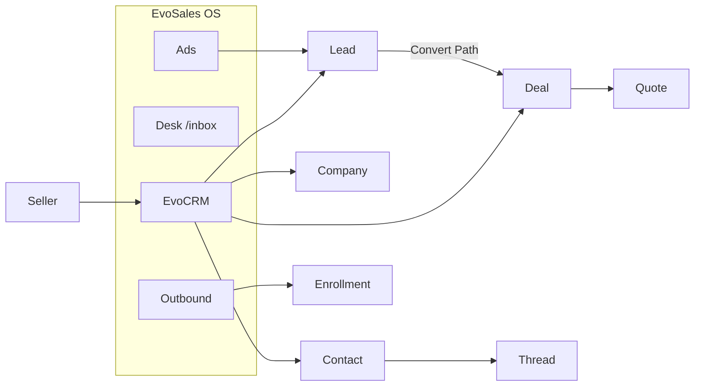

# EvoCRM — outwork HubSpot and Salesforce

| | |
|---|---|
| **Repo** | [Mohamedbeghanem/EvoSales](https://github.com/Mohamedbeghanem/EvoSales) (`main`) |
| **Product name** | EvoCRM (CRM surface). EvoSales remains the OS (CRM + Desk + Outbound + Ads). |
| **Source of truth** | Mobbin web screens of HubSpot and Salesforce. Do not invent chrome from memory. |
| **Screen freeze** | [evocrm-mobbin-contract.md](./evocrm-mobbin-contract.md) (P0) |
| **Date** | 2026-09-08 |
| **Buyer** | 5–20 seat Algeria-first sales team (DZD, wilaya, WhatsApp, Meta ads). |
| **Status** | Approved. P0–P9 on `main` or in flight; P10 remaining. |

Engineers implement against the cited Mobbin screenshot, not against this paragraph.

Related: [ARCHITECTURE.md](./ARCHITECTURE.md) · [OBJECT_MODEL.md](./OBJECT_MODEL.md) · [hubspot-side-by-side.md](./hubspot-side-by-side.md) · [crm-redesign-plan.md](./crm-redesign-plan.md)

---

## 1. Thesis

Do not clone either product. **Outwork** means a seller closes more deals per hour than on HubSpot or Salesforce.

| Steal from HubSpot (Mobbin) | Steal from Salesforce (Mobbin) | Keep / beat with EvoSales |
|---|---|---|
| Pin rail + More, list/board toggle, saved views, 3-pane record, Breeze-shaped AI rail, sequence step editor, sales workspace next-actions | Lead **Path**, **Convert**, workspace tabs, inline-edit pencils, activity composer (email/call/task/event), related lists (Opportunities / Files) | Owned SMTP + warmup, WhatsApp Cloud, Meta ads funnel, wilaya/DZD/Algiers TZ, self-host, no per-seat tax |

**Do not build (v1):** CMS/pages/blog, AppExchange, custom objects, Flow canvas, Cases/tickets, Salesforce widget home, Slack-in-CRM, e-sign/payments, SAML.

Existing HubSpot-parity score on `main` is **~85**. EvoCRM is the productization of that chrome **plus** Salesforce lead/opportunity mechanics **plus** moats visible on every surface.

---

## 2. Mobbin contract (source of truth)

Every EvoCRM surface must cite a Mobbin screen. The freeze lives in [evocrm-mobbin-contract.md](./evocrm-mobbin-contract.md). Summary:

### 2.1 HubSpot — daily seller chrome

| EvoCRM surface | Steal | Mobbin |
|---|---|---|
| Sales home | Guided actions, trophy empty, activity feed, Summary/Leads/Deals/Tasks tabs | [Sales home](https://mobbin.com/screens/1f571c85-2b3e-4f10-8125-f6aac6e49748) · [Sales workspace](https://mobbin.com/screens/87dcd39f-a9aa-461e-9fb6-5aec87d0e017) |
| Deals **list** | Saved views, filter chips, list/board toggle, Create deal, amount column, pagination | [Deals table](https://mobbin.com/screens/9e67fda1-7a17-4149-91cf-6097a5c22e2d) |
| Deals **workspace** | Preset views (Open / Stalled / No activity), stage progress bar, health score, next meeting | [Open deals](https://mobbin.com/screens/d947de05-912e-49f9-8db7-c846ac7e50ee) |
| Deals **board** | Stage columns, card (name, company, amount, close date), “No activity for N days”, High/Low, column Total + Weighted, drag | [Board](https://mobbin.com/screens/35b26dbf-8d2b-4f6c-a789-738b02d927b1) · [Won/Lost](https://mobbin.com/screens/b1e0be46-49a1-44ba-a06e-abe62d9bdebe) |
| Board editor | Compact vs Default, priority + associations, inactive after N days | [Edit board](https://mobbin.com/screens/d9777088-2fcd-4363-9f4a-eec9f1282860) |
| Contact record | 3-pane: identity + properties \| Overview/Activities/Intelligence \| AI + associations. Quick actions: Note Email Call Task Meet | [Overview](https://mobbin.com/screens/f215a882-8c79-4bf8-8483-4d8ae465c3c1) · [Activities](https://mobbin.com/screens/f93e89bd-1b63-4d1d-92d6-9753e9f4c8ba) · [Log call](https://mobbin.com/screens/344a79cd-4663-471c-b710-dd920abd0718) |
| Sequences | Manage KPIs, create from template vs scratch vs dynamic, vertical step editor, A/B, enroll empty state | [List](https://mobbin.com/screens/d0f633b6-cdf7-4c10-ba54-3a80a9df20f5) · [Create](https://mobbin.com/screens/e417eb18-bbd1-472c-893a-6489696e54c7) · [Steps](https://mobbin.com/screens/0a34649c-a49d-475b-9a2a-9da4128bc112) |
| Contacts table | Saved views, Data Quality, filters, Create contact | [Contacts](https://mobbin.com/screens/70e7b2e2-e7ca-4ee4-9fd8-bb7d881a8d27) |

### 2.2 Salesforce — lead/opportunity mechanics

| EvoCRM surface | Steal | Mobbin |
|---|---|---|
| Lead record | **Path** (New → Contacted → Nurturing → Unqualified → Converted), Convert / Change Owner / Edit, Mark Status as Complete | [Lead + Path](https://mobbin.com/screens/6443cff9-7eab-42f5-b620-1af1a9385cc6) |
| Contact record | About + Get in Touch with **inline pencils**, related Opportunities / Files, activity composer icons | [Contact](https://mobbin.com/screens/d61b0a8f-84b6-4c8f-b9a8-a3d2186b0e78) |
| Activity composer | Email / Call / Task / Event icon row, type filters, Upcoming & Overdue | [Lead timeline](https://mobbin.com/screens/6443cff9-7eab-42f5-b620-1af1a9385cc6) · [Email menu](https://mobbin.com/screens/45c8db2b-5cd1-4b82-8df9-5cfd9135acef) |
| Task as record | Details + Related, Complete, follow-up | [Task](https://mobbin.com/screens/5384fae6-9728-4b29-a40f-cb05445ac07c) |
| Leads list | Recently Viewed picker, numbered rows, bulk New/Import/Send Email/Change Owner | [Leads list](https://mobbin.com/screens/f7b32108-1960-4bc8-8509-c53f92e72ebb) |
| Contacts list | Team list views, filter panel, Assign Label | [Contacts list](https://mobbin.com/screens/5c41cc89-1e24-4ccb-9318-43eac73e3ad4) |
| Home | **Do not steal** widget soup | [SF home](https://mobbin.com/screens/7dac13de-4760-4219-9f58-dabea6659236) — anti-pattern for EvoCRM |

### 2.3 Explicit anti-patterns

- Salesforce **Slack Channel** on the record ([example](https://mobbin.com/screens/6443cff9-7eab-42f5-b620-1af1a9385cc6)) — replace with **Desk thread + WhatsApp**.
- Salesforce **widget home** — replace with HubSpot guided home.
- HubSpot **CMS / datasets explorer** ([example](https://mobbin.com/screens/1b68fa46-fe8c-41ba-a4cf-06d9de230388)) — out of scope.
- HubSpot **LinkedIn sequence steps** — skip; use WhatsApp Cloud instead.
- Copying “Breeze” or “Copilot” names — Ask Evo, orange rail, “This record” source chip.

---

## 3. Current EvoSales vs the contract

Already on `main` (use, do not rewrite):

- Pin rail + More (`resources/js/components/app-sidebar.tsx`)
- `CrmListShell`, `record-chrome.tsx`, FilterBuilder, saved views
- Deals list + `/crm/deals/board` + `/leads` board (same deal engine)
- Lead → deal convert (`deals.lead_id`)
- Ask Evo, deal health heuristic, sequences (email/call/meeting), outbound warmup
- Workspace RBAC, DZD, wilaya

Gaps vs Mobbin (this is the build):

| Gap | HubSpot SoT | Salesforce SoT | EvoSales today |
|---|---|---|---|
| Guided home | Next-actions + feed | (ignore widgets) | KPI dashboard, weak onboarding |
| Board inactivity + card editor | Board options drawer | — | Drag + totals only (P3 PR) |
| Path on leads | — | Path chevrons + Convert | Stage on deal, not Path on lead (P4 PR) |
| 3-pane + persistent AI rail | Breeze always visible | Related lists | Ask Evo exists, not always-on rail |
| Activity composer | Type chips + Log Call form | Icon composer + task record | Timeline, thinner composer |
| Sequence visual editor | Vertical steps + A/B + templates | — | Form-based steps |
| Sales workspace deals | Health score + next meeting columns | — | Health on deal page only |
| Duplicate lead/board IA | One deals object, two views | Sales hub tabs | `/leads` and `/crm/leads` both exist |

---

## 4. Product architecture

**Canonical person:** `Contact`. Lead is pre-pipeline (Salesforce). Deal is pipeline (HubSpot). Desk thread and outbound enrollment both hang off Contact.

**IA (rail) — HubSpot object-first, not Salesforce Sales hub:**

1. Home → `/dashboard` (guided)
2. Contacts → `/crm/contacts`
3. Companies → `/crm/companies`
4. Deals → `/crm/deals` (list default; board toggle)
5. Leads → `/crm/leads` (list) with Path on show; **retire `/leads` as a second product** (P9)
6. Desk / Outbound / Ads / Reports unchanged rooms

More menu keeps CRM / Desk / Outbound / Ads / Reports / Settings.

---

## 5. Surface specs (implement these)

### 5.1 Home — HubSpot sales workspace

**Files:** `resources/js/pages/home.tsx`, `HomeController`, `catch-up-block.tsx`, new `guided-actions.tsx`

Layout (from [sales home](https://mobbin.com/screens/1f571c85-2b3e-4f10-8125-f6aac6e49748)):

- Left: Guided actions (connect inbox, add contact to open deal, connect calendar) + empty trophy when tasks done
- Right: Activity feed (calls, emails, page visits) — same data as `/crm/activities`
- Top tabs optional later: Summary / Leads / Deals / Tasks (HubSpot Sales workspace). v1: single Home, deep-links into those lists
- KPI strip already exists — keep DZD pipeline value + tasks due today + unanswered WA

**Outwork:** each guided action is **real** (mailbox, Meta, Evolution), not “install tracking code”.

### 5.2 Lists — HubSpot table + Salesforce list picker

**Files:** `crm-list-shell.tsx`, `list-chrome.tsx`, `saved-view-tabs.tsx`, contacts/deals/companies/leads `index.tsx`

Must match [deals table](https://mobbin.com/screens/9e67fda1-7a17-4149-91cf-6097a5c22e2d):

- View tabs: All / My / saved / + Add view
- Filter chip row (owner, dates, stage) + Advanced filters
- List | Board toggle on deals (and leads if board exists)
- Primary CTA orange (`Create deal` / `Create contact`)
- Table: checkbox, sortable columns, Export, Edit columns, 25 per page
- Deals extra: amount with tabular DZD, stage, close date with TZ (`Africa/Algiers`)

Salesforce extras to add, not replace:

- List picker label like “Recently Viewed” / “My Team’s Contacts” ([leads list](https://mobbin.com/screens/f7b32108-1960-4bc8-8509-c53f92e72ebb))
- Bulk: Change owner, Send email (outbound), Enroll sequence

### 5.3 Deals board — HubSpot kanban

**Files:** `pipeline-kanban.tsx`, `DealController@board`, new `board-options-sheet.tsx`

Must match [board](https://mobbin.com/screens/35b26dbf-8d2b-4f6c-a789-738b02d927b1):

- Column header: stage name + count
- Card: title, company, amount DZD, close date, inactivity line, High/Low pill
- Footer: Total + Weighted (already have probability)
- Board options: sort, export, edit stages (existing pipeline admin), **edit cards** (compact/default, show associations, inactive after N days — persist on `saved_filters` or `record_layouts` for `deals_board`)
- Drag already posts `POST /crm/deals/{deal}/move`

**Outwork:** inactivity uses last activity **including WhatsApp thread + outbound open/reply**, not only CRM notes.

### 5.4 Record — HubSpot 3-pane + Salesforce Path

**Files:** `record-chrome.tsx`, `record-activity-panel.tsx`, `ask-evo-panel.tsx`, `lead-conversion-dialog.tsx`, new `record-path.tsx`

Contact/Company/Deal ([HubSpot overview](https://mobbin.com/screens/f215a882-8c79-4bf8-8483-4d8ae465c3c1)):

| Column | Content |
|---|---|
| Left | Avatar, name, title, **Note Email Call Task Meet** (and **WhatsApp**), properties with HubSpot-style sections, communication subscriptions later |
| Center | Tabs: Overview / Activities / Intelligence. Overview = data highlights + recent activities. Activities = type chips + log forms |
| Right | **Ask Evo** persistent rail (Breeze shape) + Companies / Deals / Quotes associations with + Add |

Lead show ([Salesforce Path](https://mobbin.com/screens/6443cff9-7eab-42f5-b620-1af1a9385cc6)):

- Path: New → Contacted → Nurturing → Unqualified → Converted (map to existing lead statuses; Converted fires existing qualify dialog)
- Header actions: **Convert**, Change Owner, Edit
- Right rail: **not Slack** — Desk thread preview + last WA message + open deals

Salesforce inline pencils on About / Get in Touch: PATCH field on blur (`update` already exists).

### 5.5 Activity composer

Combine:

- HubSpot [Log Call](https://mobbin.com/screens/344a79cd-4663-471c-b710-dd920abd0718) (outcome, direction, datetime, comment)
- Salesforce icon row (email opens outbound composer / Roundcube; call logs activity; task creates `Activity`; event = meeting)

Task complete from timeline without opening a full Salesforce task record in v1. Optional later: `/crm/activities/{id}` show.

### 5.6 Sequences — HubSpot editor on owned mail

**Files:** outbound sequence pages, `SequenceStep`, `DeskComposer` not involved

Match [step editor](https://mobbin.com/screens/0a34649c-a49d-475b-9a2a-9da4128bc112):

- Vertical steps, delay between, A/B on email (already `resolveAbSubject`)
- Step types: Automated email (SMTP), Call task, Meeting, **WhatsApp template** (replace LinkedIn)
- Create flow: template vs scratch ([create](https://mobbin.com/screens/e417eb18-bbd1-472c-893a-6489696e54c7))
- Empty enroll: Enroll contacts + “create workflow” linking `/crm/workflows` (`segment.entered`)

**Outwork:** warmup status and quiet hours visible on the sequence settings tab (HubSpot has neither).

### 5.7 Ask Evo rail — beat Breeze on this stack

Shape from [Breeze panel](https://mobbin.com/screens/7783b0d6-ca17-40ef-89ea-bc8752e3a6fb): always visible, collapse chevron, Ask a question, generated timestamp.

Context pack (this is the outwork): record fields + last 20 activities + last WA thread snippet + last outbound message status + ad attribution if `leads.ad_campaign_id`. Keyword RAG already exists; keep it. No Agentforce.

---

## 6. Data / API deltas

Mostly UI. Backend additions:

| Change | Why |
|---|---|
| `leads.status` path enum if not already aligned to New/Contacted/Nurturing/Unqualified/Converted | Salesforce Path |
| `saved_filters` or `workspaces.settings` JSON: `deals_board.card_style`, `inactive_after_days` | HubSpot board editor |
| `activities.last_activity_at` already on contact — use for board inactivity | HubSpot cards |
| Deal health already computed — expose on **list** columns | HubSpot sales workspace |
| Redirect `GET /leads` → `/crm/deals/board` or `/crm/leads` | Kill dual IA |
| No new objects for tickets/custom objects | Non-goal |

---

## 7. Visual system

Do not HubSpot-teal or Salesforce-blue the product.

- Evotechly: white / black / `#EC6025` only (`docs/brandbook`, `resources/css/app.css`)
- Geist 13px UI, tabular nums for DZD
- Dark rail, Light Cabinet default
- Primary CTAs orange like HubSpot orange, not SF blue **Buy Now**

---

## 8. Implementation PRs (ordered)

Each PR independently reviewable. Mobbin URL in the PR body. Pest coverage on the route.

| PR | Title | GitHub | Depends | Acceptance (Mobbin) |
|---|---|---|---|---|
| **P0** | `docs: EvoCRM Mobbin contract` | [#129](https://github.com/Mohamedbeghanem/EvoSales/pull/129) | — | Linked screens only; no new product claims |
| **P1** | `feat(home): guided sales home` | [#130](https://github.com/Mohamedbeghanem/EvoSales/pull/130) | P0 | Matches HubSpot home zones; actions hit real settings |
| **P2** | `feat(crm): list chrome vs HubSpot deals table` | [#131](https://github.com/Mohamedbeghanem/EvoSales/pull/131) | P0 | View tabs, chips, list/board toggle, Create CTA |
| **P3** | `feat(deals): HubSpot board cards + options` | [#132](https://github.com/Mohamedbeghanem/EvoSales/pull/132) | P2 | Inactivity, High/Low, compact/default persist |
| **P4** | `feat(leads): Salesforce Path + Convert chrome` | [#133](https://github.com/Mohamedbeghanem/EvoSales/pull/133) | P2 | Path + Convert/Change Owner/Edit |
| **P5** | `feat(records): 3-pane + Ask Evo rail` | remaining | P4 | 3 columns; AI always on; WA instead of Slack |
| **P6** | `feat(activities): composer + log call` | remaining | P5 | Icon composer + HubSpot log-call fields |
| **P7** | `feat(outbound): HubSpot sequence step editor` | remaining | P2 | Vertical steps, templates, WA step, enroll empty |
| **P8** | `feat(deals): workspace columns health + next step` | remaining | P3 | Health score + next activity columns |
| **P9** | `chore(ia): retire duplicate /leads board` | this PR | P3, P4 | One leads list, one deals board |
| **P10** | `test: Mobbin QA checklist Pest + screenshots` | remaining | P1–P9 | Checklist in §9 green |

Do not start P7 until P2 list chrome is the only list pattern (avoid dual UI regression).

---

## 9. QA checklist (screenshot against Mobbin)

1. Home: guided left + feed right — vs [HubSpot home](https://mobbin.com/screens/1f571c85-2b3e-4f10-8125-f6aac6e49748)
2. Deals list: views + chips + create — vs [deals table](https://mobbin.com/screens/9e67fda1-7a17-4149-91cf-6097a5c22e2d)
3. Deals board: inactivity + weighted footer — vs [board](https://mobbin.com/screens/35b26dbf-8d2b-4f6c-a789-738b02d927b1)
4. Contact show: 3-pane + Ask Evo — vs [overview](https://mobbin.com/screens/f215a882-8c79-4bf8-8483-4d8ae465c3c1)
5. Lead show: Path + Convert — vs [SF lead](https://mobbin.com/screens/6443cff9-7eab-42f5-b620-1af1a9385cc6)
6. Sequence editor: vertical steps — vs [steps](https://mobbin.com/screens/0a34649c-a49d-475b-9a2a-9da4128bc112)
7. No Salesforce blue, no “Breeze”, no Slack rail, no second `/leads` product

---

## 10. Key decisions

1. **EvoCRM is a surface on EvoSales**, not a new repo — same Laravel 13 / Inertia / React stack.
2. **HubSpot is chrome SoT; Salesforce is lead/opportunity SoT.** Mixing the other way (SF widget home + HS Path) is worse for this buyer.
3. **WhatsApp replaces Slack and LinkedIn** on the record and in sequences.
4. **No tickets, custom objects, CMS, Flow canvas in this plan.** Those are how HubSpot/Salesforce win enterprise seats, not how we outwork a 5–20 person DZ team.
5. **Board inactivity includes Desk + Outbound** — unique vs both Mobbin products.
6. **Kill dual IA** (`/leads` vs `/crm/leads`) after Path lands.

---

## 11. Alternatives considered

| Option | Why reject |
|---|---|
| Rebuild CRM from scratch as “EvoCRM” repo | Throws away ~85 HubSpot parity and outbound/ads moats |
| Clone Salesforce Lightning (widget home, related lists only) | Slower daily seller loop; Mobbin home is onboarding cards + charts, not work |
| Full HubSpot Marketing Hub (forms, pages, SEO) | Not the moat; Ads + owned mail already cover capture |
| Visual workflow canvas in this train | Deferred; form workflows exist; canvas is Omega, not outwork |

---

## 12. Risks

| Risk | Severity | Mitigation |
|---|---|---|
| Dual UI returns (hub vs chrome) | High | P2 makes `CrmListShell` the only list; Pest asserts component names |
| Path vs deal stages confuse sellers | Med | Path only on **Lead**; Deal keeps pipeline stages |
| Sequence editor rewrite breaks `outbound:run` | High | UI-only; keep SequenceStep schema |
| Ask Evo latency on every record | Med | Cached `AiInsight` row; stub without API keys |

---

## 13. Open questions (resolved)

1. **`/leads` Kommo board:** redirect in **P9** to `/crm/deals/board`. Do not keep a second pipeline product.
2. **Product string:** keep **EvoSales** in the UI. EvoCRM is the docs/surface name only.
3. **Lead Path statuses:** Path steps are **configurable**, seeded to the Salesforce five (New → Contacted → Nurturing → Unqualified → Converted) and mapped onto existing `new` / `working` / `disqualified` / `qualified`.

---

## 14. References

- Mobbin HubSpot / Salesforce screens linked in §2
- [evocrm-mobbin-contract.md](./evocrm-mobbin-contract.md)
- [hubspot-side-by-side.md](./hubspot-side-by-side.md)
- [OBJECT_MODEL.md](./OBJECT_MODEL.md)
- [ARCHITECTURE.md](./ARCHITECTURE.md)
- [crm-redesign-plan.md](./crm-redesign-plan.md)
- Sidebar: `resources/js/components/app-sidebar.tsx`
- Record: `resources/js/components/crm/record-chrome.tsx`
